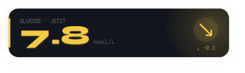

# Crimson Glucose Overlay

Ein schlankes Windows-Overlay fuer Dexcom Share Werte. Gebaut als persoenliches Always-on-top Widget mit moderner, transparenter PyQt6/QPainter-Oberflaeche statt klassischem Desktop-Formular.



## Was diese Variante ausmacht

- Frameless Desktop-Widget mit echter Transparenz
- Immer im Vordergrund und standardmaessig klickdurchlaessig
- Drag and Drop nur bei aktivierter Tray-Option
- Tray-Menue fuer Drag and Drop, Refresh, Settings und Quit
- Dexcom Share Live-Daten via `pydexcom`
- Europa/Outside-US Toggle fuer Dexcom Share Region
- mmol/L Darstellung mit Grenzwerten
- Farblogik fuer stabil, langsam steigend/fallend, schnell steigend/fallend und out-of-range
- Modernes QPainter-Rendering ohne sichtbare Standard-Widgets im Overlay
- Syne + DM Mono Fonts mit automatischem Download in `%APPDATA%/dextop/fonts`
- Idle-Fade: nach einer einstellbaren Zeit blendet das Widget auf eine reduzierte Deckkraft ab
- Settings werden lokal unter `%APPDATA%/dextop/settings.ini` gespeichert
- Zugangsdaten werden lokal verschluesselt abgelegt
- Standalone `.exe` Build per PyInstaller

## Design

Das Overlay ist bewusst als kompaktes Card-UI umgesetzt:

- dunkle, flache Card
- dezenter farbiger Zustandsglow
- linke Accent-Bar
- grosser Glukosewert als Hauptsignal
- kleine technische Labels in Mono-Schrift
- Trend-Kreis rechts mit Richtungspfeil und Delta

Farben:

- Gruen: stabil im Zielbereich
- Gelb: langsamer Trend nach oben/unten im Zielbereich
- Rot: ausserhalb der Grenzwerte oder schneller Trend
- Grau: Fehlerzustand oder kein aktueller Wert

## Projektstruktur

```text
dextop/
├─ Dextop.py              # App Einstiegspunkt
├─ app/
│  ├─ config.py           # Pfade, Farben, Fonts, Groessen
│  ├─ data.py             # Dexcom Share Polling und mmol/L Umrechnung
│  ├─ settings.py         # Settings Dialog und verschluesselte Speicherung
│  └─ widget.py           # QPainter Overlay Rendering und Interaktion
├─ assets/
│  ├─ dextop_icon.png
│  └─ icon.ico
├─ docs/
│  └─ crimson-glucose-overlay-preview.png
├─ build.bat              # PyInstaller Build
└─ requirements.txt
```

## Voraussetzungen

- Windows 10/11
- Python 3.12
- Dexcom Account mit aktivierter Share-Funktion

## Lokaler Start

```powershell
cd C:\path\to\dextop
python -m venv .venv
.\.venv\Scripts\Activate.ps1
pip install -r requirements.txt
python Dextop.py
```

Beim ersten Start oeffnet sich der Settings-Dialog. Dort eintragen:

- Dexcom Benutzername
- Dexcom Passwort
- Region: `Outside US / Europe`, wenn dein Account in Europa laeuft
- Low Threshold, Standard `4.5`
- High Threshold, Standard `10.0`
- Idle Timeout
- Idle Opacity

## Build als EXE

```powershell
.\build.bat
```

Die fertige Datei liegt danach unter:

```text
dist/Dextop.exe
```

Hinweis: PyInstaller-Onefile-EXEs koennen von einzelnen Security-Produkten als unbekannt oder false positive eingestuft werden. Der Build ist reproduzierbar aus diesem Repository.

## Bedienung

- Standardmodus: Widget ist klickdurchlaessig und blockiert keine Fenster darunter
- Tray Icon: Kontextmenue oeffnen
- `Drag and Drop aktivieren`: Widget wird interaktiv und kann per Linksklick verschoben werden
- `Refresh now`: Dexcom Wert sofort neu abrufen
- `Settings`: Zugangsdaten, Region, Grenzwerte und Fade konfigurieren
- `Quit`: Overlay beenden

Die letzte Position wird automatisch gespeichert.

## Daten und Datenschutz

Die App nutzt Dexcom Share ueber `pydexcom`. Es gibt keinen eigenen Server und keine Cloud-Synchronisierung durch dieses Projekt.

Lokal gespeicherte Daten:

```text
%APPDATA%/dextop/settings.ini
%APPDATA%/dextop/fonts/
```

Credentials werden mit `cryptography.fernet` verschluesselt. Der Schluessel wird maschinenbezogen aus dem lokalen Rechnernamen abgeleitet. Das ist fuer ein lokales Personal-Tool gedacht und ersetzt keinen Enterprise Secret Store.

## Herkunft

Diese Variante basiert auf dem MIT-lizenzierten Projekt `pFornagiel/dextop`, wurde aber fuer meinen eigenen Workflow weitgehend neu aufgebaut:

- Wechsel von Tk/Tray-UI zu PyQt6
- neues QPainter Card-Rendering
- neues Settings-System
- neue Build-Pipeline mit PyInstaller
- moderne Overlay-Optik nach eigener Crimson-Designrichtung

Der Original-Copyright-Hinweis bleibt gemaess MIT-Lizenz erhalten.

## Disclaimer

Dieses Projekt ist ein inoffizielles Personal-Tool und steht in keiner Verbindung zu Dexcom, Inc. Dexcom, Dexcom Share und alle zugehoerigen Marken gehoeren ihren jeweiligen Inhabern. Medizinische Entscheidungen sollten nicht allein auf Grundlage dieses Widgets getroffen werden.
