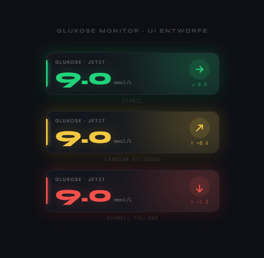

# Dexfloat

Ein kompaktes Windows-Widget für Dexcom-Share-Werte: transparent, immer im Vordergrund und standardmäßig klickdurchlässig.

> Basiert auf [dextop von Paweł Fornagiel](https://github.com/pFornagiel/dextop). Copyright-Hinweis und [MIT-Lizenz](LICENSE) bleiben erhalten.



## Anzeige und Daten

| Zustand | Verhalten |
| --- | --- |
| Im Zielbereich und bekannter flacher Trend | Grüne Anzeige |
| Steigend / fallend | Gelb mit einfachem oder diagonalem Pfeil |
| Schnell steigend / fallend | Rote Doppelpfeile; nur diese hüpfen |
| Niedrig / dringend niedrig | Roter Rahmen mit `!` / `!!`; volle Deckkraft |
| Hoch | Orangefarbener gestrichelter Rahmen mit `+` |
| Trend unbekannt | Neutrales `?`, niemals ein grüner stabiler Pfeil |
| Mindestens zehn Minuten alt oder Zeitstempel in der Zukunft | Durchgestrichener Wert, kein Pfeil, volle Deckkraft |
| Keine Daten oder Abruffehler | `--`, kein Pfeil, volle Deckkraft; Fehlerhinweis im Tray |

Das Alter wird auch ohne neue Daten laufend aktualisiert. Delta bezeichnet die Differenz zwischen den letzten zwei unterschiedlichen Sensorzeitpunkten innerhalb von 15 Minuten. Ein einzelner Wert ergibt `–`, keinen erfundenen Nullwert. Sensorzeitstempel werden übernommen; die Abrufzeit ersetzt sie nicht.

Standardgrenzen: dringend niedrig unter 3,1 mmol/L, niedrig unter 4,5 mmol/L, hoch über 10,0 mmol/L. Genau auf einer Grenze gilt die jeweils weniger kritische Kategorie. Bei Konflikten gilt: keine Daten, veraltet, dringend niedrig, niedrig, schnell fallend, hoch, schnell steigend, Trend unbekannt, fallend/steigend, im Zielbereich.

Anmeldung und Abfragen laufen in einem eigenen Thread. Netzwerk- und Sitzungsfehler werden mit wachsender Pause erneut versucht (15, 30, 60, 120, 240, höchstens 300 Sekunden). Nach abgelehnten Zugangsdaten stoppt die automatische Anmeldung. Über die Einstellungen müssen geänderte Zugangsdaten eingegeben werden. Ein Netzwerkfehler beim Autostart erzeugt keinen falschen Hinweis auf ein abgelehntes Passwort.

## Starten

Windows 10/11, Python 3.12 und ein Dexcom-Konto mit aktivierter Share-Funktion sind erforderlich.

```powershell
git clone https://github.com/cr1ms0nx64/dexfloat.git
cd dexfloat
python -m venv .venv
.\.venv\Scripts\python.exe -m pip install -r requirements.txt
.\.venv\Scripts\python.exe Dexfloat.py
```

Im Einstellungsdialog Benutzername, Passwort und Region auswählen: USA, außerhalb der USA / Europa oder Japan. Erst nach erfolgreicher Prüfung werden neue Einstellungen gespeichert und die Verbindung übernommen. Abbrechen oder eine fehlgeschlagene Prüfung lässt die bisherigen Einstellungen und die laufende Verbindung unverändert.

Im Tray-Menü sind Aktualisierung, Einstellungen, Autostart und Verschieben erreichbar. Nach dem Verschieben die Option wieder ausschalten, damit das Widget klickdurchlässig bleibt. Liegt die gespeicherte Position außerhalb der vorhandenen Bildschirme, wird das Widget auf den Hauptbildschirm verschoben.

## Lokale Daten und Schriften

Einstellungen liegen unter `%APPDATA%\dexfloat\settings.ini`. Unter Windows wird das Passwort mit DPAPI an das aktuelle Windows-Benutzerkonto gebunden und als `password_format=dpapi` markiert. Es wird kein eigener Passwortschlüssel neben der Datei gespeichert. Benutzername und übrige Einstellungen stehen im Klartext. Ein auf einen anderen Benutzer oder Rechner kopiertes Passwort kann eine neue Anmeldung erfordern.

Alte Fernet-Werte aus den Kontexten `dexfloat` und `dextop` werden weiterhin gelesen und beim nächsten Speichern auf DPAPI umgestellt. Einstellungen aus `%APPDATA%\dextop` werden nur gelesen, wenn die neue Datei noch fehlt; die alte Datei bleibt erhalten. Der bestehende Autostart-Eintrag wird migriert. Auf anderen Betriebssystemen bleibt der bisherige Fernet-Fallback bestehen; er ist schwächer, weil sein Schlüssel vom Rechnernamen abgeleitet wird.

Syne und DM Mono sind samt OFL-Lizenzen unter `assets/fonts/` gebündelt. Fehlende Schriften führen zu lokalen Ersatzschriften. Zur Laufzeit greift die App ausschließlich auf Dexcom zu; es gibt keinen Schrift-Download. `requests` bleibt für den Dexcom-Transport und dessen Zeitlimits erforderlich.

## Entwicklung und EXE-Build

```powershell
.\.venv\Scripts\python.exe -m pip install -r requirements-dev.txt
.\.venv\Scripts\python.exe -m ruff check .
.\.venv\Scripts\python.exe -m mypy app
$env:QT_QPA_PLATFORM = "offscreen"
.\.venv\Scripts\python.exe -m unittest discover -s tests
.\build.bat
```

`Dexfloat.spec` erstellt eine Ein-Datei-EXE ohne Konsolenfenster, mit Icon und allen Assets. Ergebnis: `dist\Dexfloat.exe`. Der Build muss unter Windows erfolgen. Die Windows-CI führt dieselben Prüfungen sowie den EXE-Build aus und lädt das Ergebnis als Workflow-Artefakt hoch. Tests verwenden gemockte Dexcom-, Registry-, DPAPI- und Win32-Aufrufe, keine echten Zugangsdaten.

Die API ist auf pydexcom 0.5.1 ausgerichtet. Details zur Quellprüfung, zu Abweichungen der Entwicklungsumgebung und zur manuellen Windows-Abnahme stehen im [Umsetzungsbericht](docs/implementation-report.md).

**Inoffizielles Projekt ohne Verbindung zu Dexcom, Inc.** Das Widget ersetzt keine medizinische Überwachung und ist keine alleinige Grundlage für Therapieentscheidungen.
